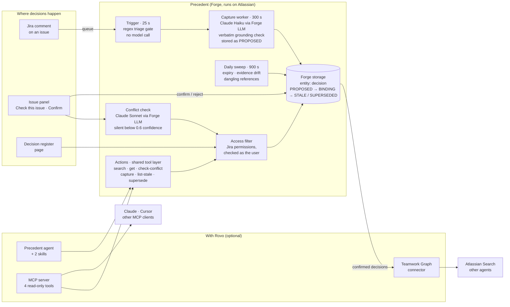

# Precedent

**Decision memory for Jira.** Precedent captures decisions where teams make them (in Jira comments), records them with the exact words they came from, warns when new work would reverse one, and flags a decision for review when the assumption it rests on expires or the source it was based on changes.

Built with Atlassian Forge for [Codegeist 2026](https://codegeist2026.devpost.com/). Runs entirely on Atlassian: no servers, databases or external calls of its own.

- **Install:** [docs/INSTALL.md](docs/INSTALL.md) (installation link, 10 minutes, free Jira site is enough)
- **Evaluation results and limitations:** [docs/EVALUATION.md](docs/EVALUATION.md)
- **Privacy:** [PRIVACY.md](PRIVACY.md) · **Security:** [SECURITY.md](SECURITY.md) · **Support:** [SUPPORT.md](SUPPORT.md)

---

## The problem

Teams settle things in Jira comments every day: which vendor, which tool, which cadence, which exception. Then the thread scrolls away. Months later nobody remembers why the team chose this, what it ruled out, or what it assumed, so the debate runs again, and any AI assistant asked about it answers from nothing.

Atlassian's Teamwork Graph connects goals, work, people and content. Decisions are not objects in it. Precedent makes them one.

## What it does

| | |
|---|---|
| **Captures** | When a Jira comment settles something, Precedent proposes a decision record: what was decided, which alternatives were rejected, which assumptions it rests on, and who said it. |
| **Grounds** | Every field the model produces must quote the source comment word for word. Anything it cannot quote is dropped before it is stored. |
| **Waits for a person** | Extracted records start as *proposed*. Only a person pressing **Confirm** makes a decision binding, citable by the agent, or visible in search. |
| **Guards** | On any Jira issue, **Check this issue** compares the work against the project's binding decisions and names the one it would reverse, with the reason. Below a confidence floor it says nothing, and says so. |
| **Reviews** | A daily sweep re-reads every source a binding decision cites. A decision is flagged *Needs review* when an assumption passes its recheck date, the cited comment has been edited in substance, or the cited issue no longer exists. |
| **Shares** | With Rovo: a **Precedent** agent in Rovo Chat, four read-only **MCP tools** for assistants such as Claude or Cursor, and a **Teamwork Graph connector** that publishes confirmed decisions to Atlassian Search. |

## Design commitments

**Nothing is recorded that cannot be quoted.** `src/lib/grounding.js` checks that each extracted claim appears verbatim in the source (after folding whitespace, markup, case and typographic punctuation) and discards it otherwise. A fabricated decision record is worse than none, so hallucination is treated as a data-integrity constraint in code, not as a prompting style.

**Nothing becomes binding without a human.** `buildDecision()` always produces status `proposed`. The tests assert it.

**Silence is a first-class outcome.** The conflict checker reports nothing below 0.6 confidence and tells the user it checked *n* decisions and found nothing. A tool that finds a problem every time is muted within a week.

**People see only what Jira lets them see.** Background work reads Jira with the app's own access. Before any derived content reaches a person, through the panel, the register, the agent or MCP, it is filtered to decisions whose project and quoted issues that person can browse, checked against Jira's permission API as the user (`src/lib/access.js`). Loading or removing sample data requires project-admin permission.

**Cost is shaped, not hoped for.** Forge LLM has no free allowance. A regular-expression gate rejects most comments before any model call; Claude Haiku does extraction; Claude Sonnet is used only for the one conflict check a person actually reads.

## Architecture



How a decision moves through the app:

1. **Comment arrives.** The trigger flattens the comment (ADF → text) and runs a free lexical gate. Discussion, questions and proposals stop here. If the comment is already cited by a decision, a drift check is queued as well.
2. **Extraction.** The capture worker asks Claude Haiku for a structured record through a forced tool call at temperature 0, then verifies every quote against the source. Ungrounded fields are dropped; a record with nothing left is not stored.
3. **Confirmation.** The record appears in the issue panel as *Awaiting confirmation*. A person confirms it or marks it *Not a decision*. Either way the record is kept, so the same comment is never extracted twice.
4. **Guarding.** On any issue in the project, the conflict check sends the issue text and the project's binding decisions to Claude Sonnet, which classifies each pair as contradicts / depends on / unrelated with a reason and a confidence. Decisions captured on the same issue are excluded. Only findings at or above 0.6 are shown.
5. **Review.** The daily sweep checks each binding decision's assumptions for passed recheck dates and re-reads each cited source. A re-hash that differs is classified by shingle similarity: formatting-only changes are ignored, edits and rewrites flag the decision with the reason.
6. **Sharing.** Confirming a decision publishes it to the Teamwork Graph when the connector is connected; rejecting or superseding removes it. The agent and MCP tools read the same register through the same access filter.

### Platform constraints the design respects

| Constraint | Handling |
|---|---|
| Trigger functions get 25 s, actions 55 s | All model work runs on async consumers with explicit `timeoutSeconds` (300 s workers, 900 s sweep) |
| `requestTeamworkGraph` exists on `asUser()` only | Graph reads happen on user-initiated paths; the background sweep records what it could not verify instead of assuming it is fine |
| A missing graph scope returns empty, not an error | Graph reads return `{rows, empty, errors}`, and the health check distinguishes "nothing found" from "not reachable" |
| Forge LLM has no free allowance | Lexical gate before any call; Haiku for volume, Sonnet for the one call a person reads; the register sent whole only when it fits a 12-decision budget |
| Custom entity storage is strictly typed | All 24 attributes are declared; writes go through `toEntity()`, which drops undeclared and empty fields |
| Web triggers cost *Runs on Atlassian* eligibility | No web trigger. Evaluations run from the register page in non-production environments |
| Apps that store account ids must report them | Weekly job reports stored account ids and erases those Atlassian reports as closed |
| Graph connector cannot mirror Jira project permissions | Declared truthfully as `replicatesPermissions: false`; the install guide tells admins when to leave it off |

## Project structure

```
manifest.yml                 Modules, scopes, storage schema, functions
src/
  actions.js                 The six actions: one implementation behind agent, skills, MCP and UI
  triggers.js                Jira comment trigger: triage, then enqueue capture and drift checks
  workers.js                 Capture worker, drift worker, daily staleness sweep
  panels.js                  UI resolvers for the issue panel and the register page
  connector.js               Teamwork Graph connector: backfill, sync, remove, index status
  privacy.js                 Weekly Personal Data Reporting job
  evals.js                   Evaluation runs (development environments only)
  seed.js                    Entry point for the sample-data worker
  engine/
    detect.js                Lexical triage gate and ADF flattening
    extract.js               Grounded extraction via forced tool calls
    conflict.js              Conflict check: candidates → model → confidence floor
    staleness.js             Expiry, evidence drift, dangling references, sweep
  lib/
    model.js                 The decision record, validation, visibility rules
    schema.js                Entity attributes and toEntity()
    store.js                 Indexed register, pagination, id allocation, scoping
    access.js                Jira permission checks as the current user
    llm.js                   Forge LLM structured calls, model names, usage logging
    grounding.js             Verbatim-quote enforcement
    hash.js                  Normalisation, content hashing, drift classification
    graph.js                 Teamwork Graph reader
    graph-object.js          Decision → graph document mapping
    privacy-core.js          Account collection and erasure, Forge-free
    log.js                   Budgeted structured logging (no quotes, no account ids)
    site.js, url.js          Site URL and URL helpers
  frontend/
    panel.jsx                Issue panel (UI Kit)
    register.jsx             Decision register page (UI Kit)
  seed/
    data.js                  Sample work items and decisions
    seed.js                  Load and remove sample data
skills/
  decision-historian/        Rovo skill: answer "why did we decide X?"
  decision-guard/            Rovo skill: check a plan against precedent
resources/agent/             Agent prompt
static/icons/                Panel and connector icons
eval/
  score.js                   Scorers and thresholds
  datasets/                  Tuning and held-out sets for extraction and conflict
test/                        59 tests over the Forge-free logic (npm test)
docs/
  INSTALL.md                 Install and first-run guide
  EVALUATION.md              Results, what they do not show, changes they informed
```

## Permissions

14 scopes, each tied to something the code does:

| Scope | Used for |
|---|---|
| `read:jira-work`, `read:jira-user` | Reading comments and issues to capture decisions and run the conflict check; resolving who decided |
| `write:jira-work` | Sample data only: creating and removing demo work items when a project admin asks |
| `storage:app` | The decision register |
| `read:object:jira`, `write:object:jira`, `delete:object:jira` | Teamwork Graph connector: publish, check index status, remove |
| `read:graph:issue:jira`, `read:graph:issue-comment:jira`, `read:graph:project:jira`, `read:graph:user:atlassian`, `read:graph:team:atlassian`, `read:graph:page:confluence` | Teamwork Graph reads for context (one scope per object type) |
| `read:chat:rovo` | Lets Rovo agents call the actions as tools |

No external egress is declared. AI runs on Forge LLM (Anthropic Claude models hosted by Atlassian): `claude-haiku-4-5-20251001` for extraction, `claude-sonnet-4-5-20250929` for conflict checks.

## Evaluation

The model-backed steps are scored against labelled datasets, with a held-out set written after the prompts were fixed. On the held-out set: extraction precision and recall 100% (21 cases), contradictions caught 100%, false alarms 0% (67 pairs), free triage gate 90.9%. Three runs at temperature 0 gave identical results.

These are small, developer-written datasets. They catch regressions; they do not establish production accuracy. The full results, the misses, and what the numbers do not show are in [docs/EVALUATION.md](docs/EVALUATION.md). Evaluations can be re-run on a development install from **Apps → Decision register → Run evaluation**.

## Running the tests

```bash
npm install
npm test
```

The engine and library modules have no Forge imports by design, so the logic that decides what reaches the register is tested without a deployed app: triage, grounding, drift classification, scoping, visibility, schema conformance, the offline evaluation scorers, and a scan that keeps account ids and quotes out of logs.

## Licence

[MIT](LICENSE)
